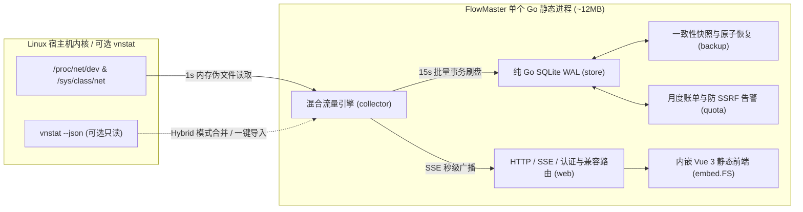

# FlowMaster 系统架构说明

## 设计目标

FlowMaster 采用**单静态二进制 + 内置 SQLite + 嵌入式现代 SPA** 架构，解决传统监控面板依赖外部运行时、频繁派生子进程采样以及容器化困难的问题：

## 核心模块职责

| 目录 | 职责说明 |
| :--- | :--- |
| `VERSION` + `embed.go` | 全仓唯一版本源与前端 `web/dist` 编译期嵌入桥接 |
| `cmd/flowmaster` | CLI 参数解析（`--version`、`--help`、`-env-file`）、组件装配与信号优雅退出 |
| `internal/config` | 环境变量与 `.env` 解析、越界兜底、`session.key` 高强度随机密钥生成（`0600`） |
| `internal/logger` | `system` 与 `alert` 双通道脱敏日志、内存环形缓冲与单文件 2 MiB 自动轮转 |
| `internal/collector` | `/proc/net/dev` 计数器回绕安全差分、`vnstat --json` 参数化解析、SSE 广播与混合路由 |
| `internal/store` | 纯 Go SQLite（`modernc.org/sqlite`）多粒度聚合表、`VACUUM INTO` 快照与原子换库回滚 |
| `internal/quota` | VPS 月度重置日区间计算、四向计费统计及禁重定向 + 内网拦截的 Webhook/Telegram 推送 |
| `internal/cluster` | 同二进制 `1 Hub + N Agents` 多机统一纳管：Agent 3s 主动心跳上报与 25s HTTP 长轮询反向 RPC 隧道（穿透 NAT / 纯 IPv6） |
| `internal/updater` | 预编译二进制远程 OTA 原子自升级（含国内 GitHub 加速池回退、`SHA256SUMS` 强校验与换包前 `--version` 预检） |
| `internal/web` | IPv4/IPv6 双栈监听、PBKDF2 口令认证、防爆破限流、动态 `Secure` Cookie、`/api/v1/*`（含集群管理路由）与旧版 `/api/*` 兼容层 |
| `web/` | Vue 3 + Vite + Tailwind CSS + 按需裁剪 Chart.js 构建的单机看板、多机矩阵总览与可视化管理中心 |
